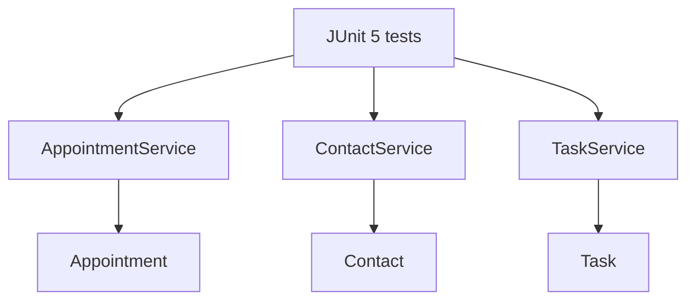

# Java Service Testing | Appointments, Contacts and Tasks

**Three small Java domain services with validation rules, JUnit 5 tests and a reproducible Maven build.**

[](https://github.com/xtyledan/Java-Service-Testing-Appointment-Contact-Task-Management/actions/workflows/java-tests.yml) · [Source](AppointmentService.java) · [MIT License](LICENSE)

## Architecture overview



*This is a source-structure diagram, not a screenshot of a deployed application.*

## Why it exists

A small service can still fail through invalid input or unexpected state changes. This coursework project isolates appointment, contact and task operations so validation rules and expected service behavior can be unit-tested.

## What's included

| Domain | Implementation | Tests |
| --- | --- | --- |
| Appointments | [Appointment.java](Appointment.java), [AppointmentService.java](AppointmentService.java) | [AppointmentTest.java](AppointmentTest.java), [AppointmentServiceTest.java](AppointmentServiceTest.java) |
| Contacts | [Contact.java](Contact.java), [ContactService.java](ContactService.java) | [ContactTest.java](ContactTest.java), [ContactServiceTest.java](ContactServiceTest.java) |
| Tasks | [Task.java](Task.java), [TaskService.java](TaskService.java) | [TaskTest.java](TaskTest.java), [TaskServiceTest.java](TaskServiceTest.java) |

The tests cover representative valid/invalid inputs and service operations. Appointment dates are defensively copied so external changes to a mutable `Date` cannot silently bypass setter validation.

## Run the tests

Requires Java 11+ and Maven (the CI job uses Java 17).

```bash
git clone https://github.com/xtyledan/Java-Service-Testing-Appointment-Contact-Task-Management.git
cd Java-Service-Testing-Appointment-Contact-Task-Management
mvn test
```

**Usage example:** Open [AppointmentTest.java](AppointmentTest.java) to see how a future appointment is constructed and how past or missing dates are rejected. Run the test suite above to exercise the behavior.

The original source files live at the repository root. [pom.xml](pom.xml) configures compilation and Surefire; [GitHub Actions](https://github.com/xtyledan/Java-Service-Testing-Appointment-Contact-Task-Management/actions/workflows/java-tests.yml) runs the tests.

## Tradeoffs and limitations

The services use in-memory lists rather than a database; there is no persistent storage, REST API, user interface, authentication or production security assessment. This is deliberately a unit-testing project, so a fabricated application screenshot or live-demo URL would misrepresent it. A future extension could add persistence and integration tests.

**License:** [MIT](LICENSE). [GitHub profile](https://github.com/xtyledan)
